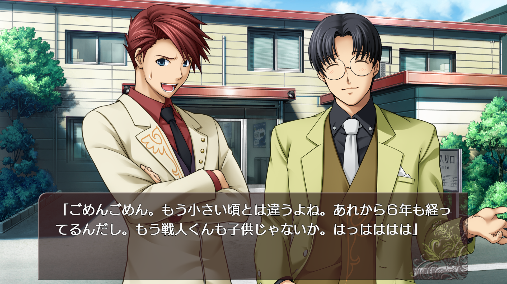

# Open Catbox Project

A native PC port of the Nintendo Switch release of *Umineko no Naku Koro ni Saku ~Nekobako to Musou no
Koukyoukyoku~* (title id `01006A300BA2C000`), built to be played with your own copy of the game and the fan-made
**Catbox** English patch.

The engine is an independent continuation of [shin](https://github.com/DCNick3/shin) by DCNick3, an unofficial
re-implementation of the visual-novel engine Entergram uses on Switch, PS4 and PS Vita. Upstream development has
slowed down, so this project keeps going on its own: every engine value is taken from the original executable through
reverse engineering instead of being guessed, and everything learned is written down in [`research/`](research/) so
others can work with it too.

## Status

Not fully playable yet. On top of shin, this project so far adds:

- Pictures with differentially-encoded blocks (the English patch's images now load)
- Rain, snow, petal and golden-snow particle layers
- The whirl and glass-shatter screen transitions
- The `SEONCE`, `BGMSYNC`, `VOICEWAIT`, `WIPEWAIT`, `SYSSE`, `SYSCALL` and `EXIT` script commands
- Fixes for movie playback (deadlocks and clips decoding truncated or empty)

Still missing, in rough order: layer effects (dissolve, blur, ripple, mosaic, raster), story choices and the quiz,
voice playback, and the menus. [`research/docs/engine-internals.md`](research/docs/engine-internals.md) keeps the
full list, built from a static analysis of the whole game script.



## Running it

You need your own dump of the game (title id `01006A300BA2C000`), for example made with
[nxdumptool](https://github.com/DarkMatterCore/nxdumptool), and its romfs extracted with
[hactoolnet](https://github.com/Thealexbarney/LibHac):

```bash
hactoolnet -t pfs0 "Umineko no Naku Koro ni Saku ~Nekobako to Musou no Koukyoukyoku~ [01006A300BA2C000].nsp" --romfs=assets
```

The `assets` directory should contain a `data.rom` with sha256
`6d90eb0bacacf769a7e4634407622b047acd711c47debb28136d7bab3fd0e591`. For English, put the Catbox patch's `patch.rom`
next to it; it is layered over `data.rom`. Then point the engine at that directory with the `SHIN_ASSETS` environment
variable, or put it next to the executable.

Movies need `ffmpeg` on your `PATH`.

Controls:

- Mouse click, space, enter - advance text
- Ctrl - fast-forward text
- Escape, Q - quit
- F3 - show overlay menu
- F10 - resize to 1080p
- F11 - toggle fullscreen

Set `RUST_LOG` (for example `warn,shin=debug,shin_video=debug`) to get logs.

## Building from source

Install [Rust](https://www.rust-lang.org/), then:

```bash
cargo build --release -p shin
```

Use the release profile: the unoptimised debug build overflows the main thread's stack at startup.

## What else is in the box

- `shin-core`: a library for the game's data formats.
- `sdu`: a command-line tool on top of it to extract and convert game data (`.rom` archives, `.bup` sprites, `.pic`
  pictures, `.nxa` audio, `.snr` scenarios, `.fnt` fonts, `.txa` texture archives).
- [`research/`](research/): reverse-engineering notes, Ghidra scripts and the symbol map of the original executable.

## Credits and license

The engine is based on [shin](https://github.com/DCNick3/shin), created by DCNick3 with the help of its contributors,
all listed in [CREDITS.md](CREDITS.md). Like shin, this project is licensed under the
[Mozilla Public License 2.0](LICENSE).

## Disclaimer

This project is not affiliated with Entergram, 07th Expansion or the Catbox translation team. It is an unofficial fan
project. It contains no game data, keys or decompiled code: you need to own the game to play it.
